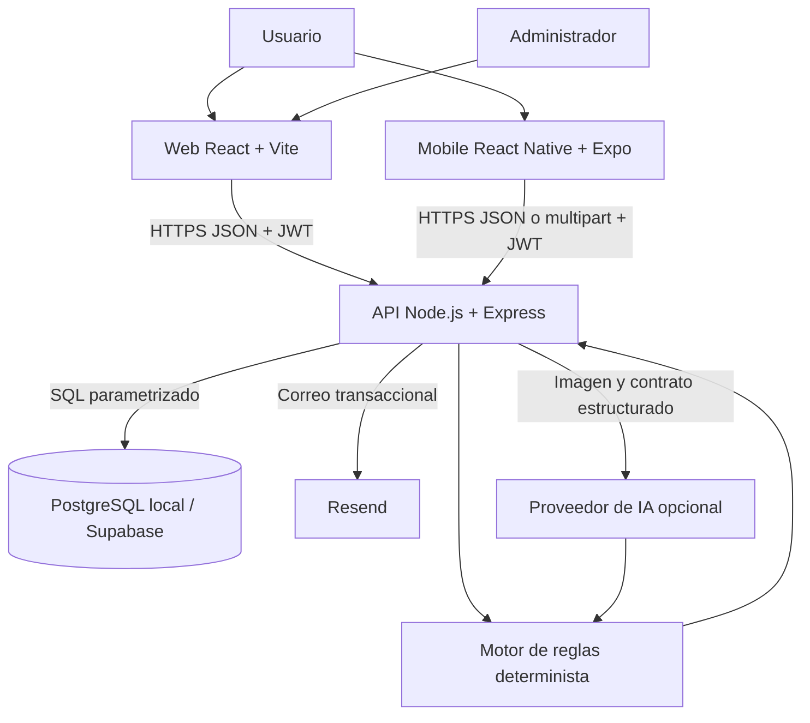
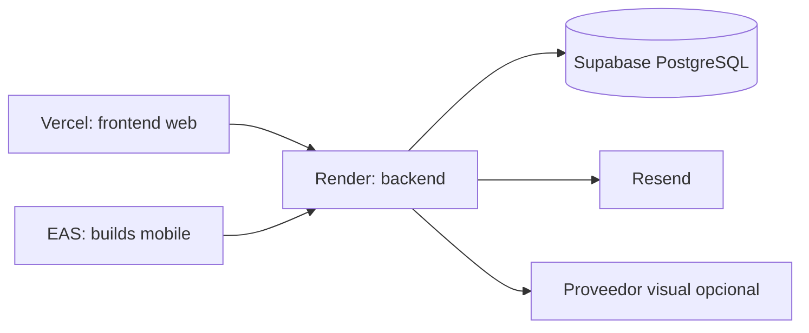

# Guía de Estudio y Exposición Técnica de NutriEdu

Documento de referencia para estudiar, presentar y defender técnicamente el proyecto ante docentes, jurados y otros evaluadores.

> NutriEdu es una herramienta educativa y de apoyo alimentario. No diagnostica enfermedades, no prescribe tratamientos y no reemplaza la valoración de profesionales de salud.

## 1. Resumen ejecutivo

NutriEdu es un sistema multiplataforma que personaliza la consulta de recetas y la planificación alimentaria a partir de restricciones, objetivos, condiciones clínicas confirmadas y metas nutricionales del usuario.

El producto está compuesto por:

- una aplicación web para usuarios y administradores;
- una aplicación móvil para Android e iOS;
- una API REST central;
- una base de datos PostgreSQL;
- correo transaccional mediante Resend;
- análisis opcional de imágenes mediante un proveedor de IA;
- un motor determinista que evalúa seguridad y compatibilidad nutricional.

La decisión central de arquitectura es que **los clientes muestran y capturan información, pero el backend conserva la autoridad sobre identidad, reglas, seguridad y persistencia**. La IA propone datos estructurados, mientras que las decisiones finales pasan por validación del backend y revisión humana.

## 2. Problema y propuesta de valor

### Problema

Las aplicaciones de recetas generales suelen ignorar alergias, intolerancias, condiciones clínicas, objetivos personales y límites nutricionales. Esto obliga al usuario a interpretar manualmente si una receta es compatible con su situación.

### Propuesta

NutriEdu reúne el perfil del usuario y lo utiliza para:

1. excluir recetas con ingredientes incompatibles;
2. evaluar nutrientes como calorías, proteína, azúcar, grasa saturada, fibra y sodio;
3. organizar un plan semanal;
4. generar una lista de compras;
5. analizar fotografías de comida con revisión humana;
6. revisar información extraída de documentos médicos sin aplicar cambios automáticamente;
7. ofrecer herramientas administrativas para mantener los catálogos y observar la operación.

### Alcance académico

El proyecto demuestra integración entre desarrollo web, mobile, API REST, seguridad, base de datos relacional, servicios externos, IA controlada, despliegue y pruebas. Las reglas actuales son una base técnica y no un protocolo clínico validado.

## 3. Arquitectura general



### Estilo arquitectónico

- **Cliente-servidor:** web y mobile consumen la misma API.
- **API REST:** recursos organizados por usuarios, perfiles, recetas, planificación, análisis, documentos, notificaciones y administración.
- **Arquitectura por capas:** rutas, middleware, controladores, servicios y acceso a PostgreSQL.
- **Proveedor externo desacoplado:** Resend y el proveedor visual se invocan únicamente desde backend.
- **Configuración por entorno:** URLs, secretos, base de datos y proveedor de IA se configuran con variables de entorno.

### Razones de diseño

- Evitar duplicar reglas clínicas en web y mobile.
- Mantener secretos fuera de los clientes.
- Permitir reemplazar servicios externos sin rehacer la interfaz.
- Usar integridad relacional para proteger asociaciones entre usuarios, recetas y catálogos.
- Separar estimaciones de IA de decisiones deterministas y confirmadas.

## 4. Composición del workspace

```txt
NutriEdu/
├── nutriedu-backend/       API REST, servicios, migraciones y pruebas
├── nutriedu-frontend/      Aplicación web y panel administrativo
├── nutriedu-mobile/        Aplicación React Native con Expo
├── docs/                   Arquitectura, base de datos, roadmap y bitácora
├── Schemas/                Datos CSV iniciales
└── README.md               Entrada general del workspace
```

Los tres productos mantienen historiales Git independientes:

- backend: repositorio `xrhon0s/NutriEdu`;
- frontend: repositorio `xrhon0s/NutriEdu-frontend`;
- mobile: repositorio local todavía sin remoto configurado.

## 5. Frontend web

### Tecnologías

- React 19;
- Vite 7;
- React Router DOM;
- Axios;
- Tailwind CSS.

### Responsabilidades

- registro, login y recuperación de contraseña;
- configuración del perfil;
- consulta y detalle de recetas;
- planificador semanal y lista de compras;
- protección visual de rutas privadas;
- panel administrativo;
- almacenamiento del JWT y usuario en `localStorage`;
- envío automático de `Authorization: Bearer <token>` mediante interceptor Axios.

La capa visual está migrando a tokens semánticos y componentes compartidos. `AppShell`, encabezados, mensajes, estados vacíos, botones y paginación ya forman una base común. La navegación autenticada cambia a menú accesible por debajo de 1024 px y la vista de recetas utiliza filtros etiquetados, tarjetas compactas, iconografía Lucide, skeletons y reintento explícito sin alterar el contrato de recomendaciones. El detalle separa seguridad, descripción, nutrición por porción e ingredientes reales; los datos nutricionales no registrados se declaran pendientes. El planificador distingue estado guardado y cambios locales, y bloquea planes incompatibles igual que el backend. Compras agrega ingredientes por cantidad o unidad, los agrupa por familia, conserva recetas de origen y separa checks por usuario y versión del plan. El perfil conserva cuatro áreas de guardado, muestra prioridad de objetivos y agrupa los límites diarios por función. Autenticación y recuperación comparten estructura, política visible, confirmación de contraseña y estados de solicitud; un fallo posterior al login no invalida una sesión ya emitida. Las alternativas son orientación y todavía no se persisten como reemplazos.

### Rutas principales

| Ruta | Función |
| --- | --- |
| `/register` | Crear cuenta |
| `/login` | Iniciar sesión |
| `/forgot-password` | Solicitar recuperación |
| `/reset-password` | Establecer nueva contraseña |
| `/profile` | Restricciones y perfil |
| `/recipes` | Catálogo seguro y filtros |
| `/recipes/:id` | Detalle y evaluación de receta |
| `/planner` | Plan semanal |
| `/shopping-list` | Lista derivada del plan |
| `/admin/recipes` | Panel para rol `administrador` |

### Panel administrativo actual

Implementado:

- resumen operativo;
- navegación administrativa responsive: lateral en escritorio y selector en mobile;
- cobertura de perfiles;
- calidad accionable del catálogo: nutrición completa/revisada, cantidades y taxonomía de ingredientes;
- consumo agregado y presupuesto de IA;
- estado del ledger de migraciones;
- CRUD de recetas e ingredientes;
- usuarios con búsqueda, filtro, paginación y conteos clínicos;
- usuarios responsive mediante tarjetas mobile y tabla de columnas prioritarias;
- cambio protegido de roles con confirmación explícita;
- creación, búsqueda, paginación, edición, activación y desactivación de objetivos y condiciones;
- creación, edición y activación de reglas nutricionales con alcance validado;
- creación, edición y desactivación no destructiva de restricciones;
- auditoría paginada de solicitudes de IA, tokens, costos y errores;
- visualización de la política de costo de IA en modo de solo lectura.
- reglas, restricciones y auditoría de IA responsive con filtros, estados y paginación compartida;
- búsqueda y paginación de recetas, ingredientes y restricciones;
- clasificación administrativa de ingredientes por grupo alimentario y grupo de sustitución culinaria.
- búsqueda y paginación visual de restricciones del perfil conservando la selección entre páginas.
- selector paginado y buscable de ingredientes al crear o editar recetas, con selección persistente entre páginas.
- gestión responsive de recetas e ingredientes mediante tarjetas mobile, tablas de columnas prioritarias y confirmaciones accesibles.

Pendiente:

- operación de notificaciones;
- auditoría administrativa;
- reportes y exportaciones.

## 6. Aplicación móvil

### Tecnologías

- React Native 0.86;
- Expo SDK 57;
- Expo Router;
- TypeScript;
- Expo SecureStore;
- Expo Notifications;
- Expo Image Picker y Document Picker;
- i18next.

### Responsabilidades

- experiencia cotidiana en Android e iOS;
- almacenamiento cifrado del JWT mediante SecureStore;
- consulta de recetas con paginación;
- recetas guardadas sincronizadas por cuenta y revalidadas frente al perfil actual;
- perfil avanzado y metas;
- plan y compras;
- lista de compras agrupada con cantidades, recetas de origen y progreso por version del plan;
- captura de fotos de comida;
- selección de documentos médicos;
- consentimiento y revisión humana;
- bandeja de notificaciones y recordatorios locales;
- privacidad y eliminación de cuenta.

### Navegación mobile

Las rutas se definen por archivos con Expo Router. Los grupos principales incluyen inicio, perfil, recetas, análisis, plan, compras, documentos médicos, historial, notificaciones y privacidad. Inicio agrega respuestas de perfil, ranking, plan y notificaciones sin recalcular reglas en el dispositivo; si una fuente secundaria falla conserva las demás secciones. Perfil resume las señales activas que consume el motor y separa datos personales, objetivos, salud y metas; no interpreta la ausencia de condiciones médicas como información incompleta. El plan muestra un día por vez, identifica cambios sin guardar y agrega calorías, proteína, carbohidratos y grasa de la semana. La cobertura se calcula por nutriente para distinguir un dato completo de un catálogo todavía parcial.

### Desarrollo Android

El APK actual es un **development client**, no una aplicación autónoma. Durante desarrollo necesita:

1. backend activo;
2. Metro activo;
3. teléfono y computador en la misma red;
4. URL LAN actual del computador.

El comando `npm run android:lan` detecta la IP, actualiza el entorno local, comprueba la API e inicia Metro.

El perfil EAS `preview` produce un APK autónomo para aceptación interna: no necesita Metro ni Expo Go y apunta explícitamente a `https://nutriedu-backend.onrender.com/api`. El perfil `production` usa la misma API y genera el artefacto de tienda. Development conserva la URL LAN local.

### Estado de notificaciones

- bandeja interna y preferencias persistentes implementadas;
- horarios diarios y semanales implementados;
- prueba local de cinco segundos implementada;
- diagnóstico de permiso y recordatorios programados por dispositivo implementado;
- horas silenciosas con selectores visuales y alerta de diferencia de zona horaria implementadas;
- cancelación de recordatorios al cerrar o expirar la sesión implementada;
- permiso Android para alarmas exactas incorporado al siguiente build;
- aceptación física definitiva y push remoto todavía pendientes.

## 7. Backend y API REST

### Tecnologías

- Node.js;
- Express 5;
- PostgreSQL mediante `pg`;
- bcrypt;
- JSON Web Token;
- Multer para cargas en memoria;
- Resend;
- dotenv y CORS.

### Capas

```txt
Petición HTTP
  -> server.js
  -> router del módulo
  -> verifyToken / verifyAdmin
  -> controlador
  -> servicio de dominio o proveedor
  -> consultas SQL parametrizadas
  -> respuesta JSON
```

### Familias de endpoints

| Prefijo | Responsabilidad |
| --- | --- |
| `/api/users` | Registro, login, recuperación, restricciones y eliminación |
| `/api/profile` | Perfil, objetivos, condiciones, metas y catálogos |
| `/api/recipes` | Búsqueda, detalle, seguridad y evaluación |
| `/api/planner` | Plan semanal y compras |
| `/api/food-analysis` | Intake, análisis y revisión de comida |
| `/api/medical-documents` | Intake, revisión, aplicación, historial y retención |
| `/api/notifications` | Inbox, lectura, preferencias y horarios |
| `/api/admin` | Operación, usuarios y mantenimiento de catálogos |

### Autenticación y autorización

1. El usuario entrega correo y contraseña.
2. El backend busca la cuenta.
3. bcrypt compara la contraseña con `password_hash`.
4. El backend firma un JWT con `JWT_SECRET`.
5. El cliente envía el token en cada petición privada.
6. `verifyToken` valida la firma y confirma que el usuario todavía existe.
7. `verifyAdmin` vuelve a consultar el rol para rutas administrativas.

La protección del frontend mejora la experiencia, pero la autorización real siempre ocurre en backend.

## 8. Base de datos

### Motor

PostgreSQL se usa localmente y Supabase proporciona PostgreSQL administrado para producción.

### Modelo relacional resumido

```mermaid
erDiagram
    USUARIOS ||--o| PERFILES_USUARIO : tiene
    USUARIOS ||--o{ USUARIO_RESTRICCIONES : selecciona
    RESTRICCIONES ||--o{ USUARIO_RESTRICCIONES : clasifica
    RESTRICCIONES ||--o{ INGREDIENTE_RESTRICCIONES : afecta
    INGREDIENTES ||--o{ INGREDIENTE_RESTRICCIONES : relacionado
    RECETAS ||--o{ RECETA_INGREDIENTES : contiene
    INGREDIENTES ||--o{ RECETA_INGREDIENTES : integra
    USUARIOS ||--o{ PLAN_SEMANAL : organiza
    RECETAS ||--o{ PLAN_SEMANAL : asignada
    USUARIOS ||--o{ USUARIO_RECETAS_FAVORITAS : guarda
    RECETAS ||--o{ USUARIO_RECETAS_FAVORITAS : marcada
    USUARIOS ||--o{ USUARIO_OBJETIVOS : define
    OBJETIVOS_NUTRICIONALES ||--o{ USUARIO_OBJETIVOS : elegido
    USUARIOS ||--o{ USUARIO_CONDICIONES : confirma
    CONDICIONES_CLINICAS ||--o{ USUARIO_CONDICIONES : clasifica
    USUARIOS ||--o| USUARIO_METAS_NUTRICIONALES : limita
    USUARIOS ||--o{ VISION_ANALYSIS_USAGE : consume
    USUARIOS ||--o{ REVISIONES_DOCUMENTOS_MEDICOS : revisa
    REVISIONES_DOCUMENTOS_MEDICOS ||--o| APLICACIONES_DOCUMENTOS_MEDICOS : aplica
    USUARIOS ||--o{ NOTIFICATIONS : recibe
    USUARIOS ||--o| NOTIFICATION_PREFERENCES : configura
```



### Grupos de tablas

#### Núcleo original

| Tabla | Propósito |
| --- | --- |
| `usuarios` | Cuenta, correo, hash, rol y registro |
| `restricciones` | Catálogo alimentario |
| `ingredientes` | Catálogo, nutrientes por 100 g, grupo alimentario y grupo de sustitución culinaria |
| `recetas` | Receta, descripción, calorías, tiempo, salud y nutrientes |
| `usuario_restricciones` | Restricciones elegidas por usuario |
| `ingrediente_restricciones` | Ingredientes incompatibles con restricciones |
| `receta_ingredientes` | Composición de cada receta |
| `usuario_recetas_favoritas` | Relación sincronizada entre cuenta y recetas guardadas |
| `plan_semanal` | Receta por usuario, día y tipo de comida |
| `password_reset_tokens` | Hash, expiración y uso del token de recuperación |

#### Perfil clínico

| Tabla | Propósito |
| --- | --- |
| `perfiles_usuario` | Edad, sexo, estatura, peso, actividad, hábitos y preferencias |
| `objetivos_nutricionales` | Catálogo con código estable y estado activo |
| `usuario_objetivos` | Objetivos, prioridad y estado por usuario |
| `condiciones_clinicas` | Condición, nivel de riesgo y guía profesional |
| `usuario_condiciones` | Condiciones confirmadas y su fuente |
| `reglas_nutricionales` | Límites por objetivo, condición o regla global |
| `usuario_metas_nutricionales` | Rangos diarios personalizados |

#### IA, documentos y operación

| Tabla | Propósito |
| --- | --- |
| `vision_analysis_usage` | Cuota, tokens, costo reservado, costo real y estado |
| `revisiones_documentos_medicos` | Extracción estructurada revisada, sin archivo original |
| `aplicaciones_documentos_medicos` | Confirmación y cambios exactos aplicados |
| `notifications` | Bandeja interna por usuario |
| `notification_preferences` | Zona horaria, categorías, silencio y horarios |
| `schema_migrations` | Versión, archivo, checksum y fecha de migración |

### Integridad y eliminación

- Las claves foráneas evitan referencias a registros inexistentes.
- Las relaciones propiedad del usuario usan `ON DELETE CASCADE`.
- Los catálogos clínicos se desactivan en lugar de eliminarse.
- La eliminación de cuenta se ejecuta en transacción.
- El último administrador no puede eliminarse ni perder su rol.

### Migraciones

| Versión | Cambio |
| --- | --- |
| `001` | Perfil clínico, objetivos, condiciones, reglas, metas y nutrientes |
| `002` | Control durable de uso y costo de visión |
| `003` | Auditoría estructurada de documentos médicos |
| `004` | Retención y expiración de revisiones |
| `005` | Cascadas para eliminación integral de cuenta |
| `006` | Inbox y preferencias de notificaciones |
| `007` | Horarios configurables de recordatorios |
| `008` | Ciclo de vida no destructivo del catálogo de restricciones |
| `009` | Grupos alimentarios para ingredientes e índice de consulta |
| `010` | Porciones, procedencia nutricional y cantidades por ingrediente |
| `011` | Claves externas, revisión y auditoría de importaciones de catálogo |
| `012` | Grupos culinarios estrictos para alternativas de ingredientes |

El runner usa selección explícita, checksum SHA-256, advisory lock y verificadores para las doce versiones. `baseline` registra una migración ejecutada manualmente solo después de comprobar sus objetos esenciales.

## 9. Motor de seguridad alimentaria

### Filtro por restricciones

```txt
Restricciones del usuario
  -> ingredientes asociados
  -> recetas que contienen esos ingredientes
  -> exclusión de incompatibles
  -> catálogo seguro
```

### Alternativas cercanas

La sustitución se resuelve después de detectar incompatibilidad y no altera el ranking ni la receta guardada. `food_group` agrupa por función nutricional amplia, mientras `substitution_group` exige proximidad culinaria. El backend elimina candidatos restringidos, ya presentes en la receta o de otro grupo; si no existe una opción equivalente devuelve una lista vacía. Así, `pollo` (`poultry`) no recomienda `tofu` (`plant_protein`) aunque ambos pertenezcan a `protein`.

### Evaluación nutricional

El motor combina:

- restricciones;
- objetivos activos;
- prioridad de objetivos;
- condiciones y nivel de riesgo;
- metas diarias convertidas según comidas por día;
- variables antropométricas y actividad cuando aplica EER;
- tiempo disponible para cocinar.

El listado usa `GET /api/recipes/recommendations` para excluir incompatibles y ordenar de forma determinista. Cada receta conserva explicaciones, advertencias, confianza y nutrientes faltantes. Los datos desconocidos reducen confianza: nunca se interpretan como cumplimiento.

Para ampliar el catálogo existe una plantilla canónica formada por tres hojas CSV y ejemplos JSON. Las claves externas evitan depender de IDs distintos entre desarrollo y producción. El panel permite descargar, seleccionar y previsualizar el lote; solo habilita la confirmación cuando el backend lo aprueba. La importación vuelve a resolver identidades bajo un lock, aplica el lote en una transacción y genera auditoría. La conversión directa desde CSV y el cálculo nutricional automático siguen pendientes.

La salida contiene:

- puntuación de 0 a 100;
- estado de compatibilidad;
- ingredientes inseguros;
- alertas por nutrientes;
- razones favorables y datos faltantes;
- contexto usado en la evaluación.

Si falta un nutriente, el sistema no inventa un valor para completar la evaluación: lo registra y reduce la confianza del resultado.

## 10. Inteligencia artificial

### Separación de responsabilidades

La IA intenta reconocer plato, ingredientes, porción y nutrientes. El motor de NutriEdu evalúa esos datos contra reglas explícitas. Esta separación permite auditar por qué apareció una alerta y evita delegar toda la decisión a un modelo probabilístico.

### Flujo de análisis de comida

```txt
Foto -> validación MIME/firma/tamaño -> consentimiento
     -> reserva de cuota y presupuesto
     -> proveedor visual opcional
     -> validación del esquema 1.0
     -> evaluación determinista
     -> corrección humana
     -> reevaluación sin costo adicional de IA
```

### Controles de costo

- proveedor desactivable por entorno;
- límite diario por usuario;
- presupuesto mensual global;
- reserva previa a la llamada;
- liberación de reserva en fallos;
- registro de tokens y costo estimado;
- imágenes no almacenadas por NutriEdu.

### Documentos médicos

El intake acepta PDF, JPEG y PNG bajo límites de tamaño y firma. Actualmente existe el contrato estructurado, revisión, aplicación confirmada, historial y retención. La extracción clínica real con OCR/IA todavía no debe presentarse como terminada.

Regla de seguridad: **la IA no confirma diagnósticos ni modifica el perfil automáticamente**.

## 11. Notificaciones

NutriEdu separa dos conceptos:

- **inbox:** registros persistentes consultados desde la API;
- **recordatorios locales:** avisos programados por el sistema operativo del teléfono.

Las preferencias incluyen zona horaria, horas silenciosas, categorías y horarios. No existe todavía un proveedor de push remoto ni almacenamiento de tokens de dispositivo.

## 12. Correo transaccional

Resend se integra desde backend para:

- bienvenida;
- recuperación de contraseña.

El token de recuperación se genera aleatoriamente. La base de datos conserva SHA-256 del token, no el valor enviado por correo. La nueva contraseña se almacena nuevamente con bcrypt.

Las contraseñas nuevas se validan en registro y restablecimiento: 10 a 72 caracteres, con mayúscula, minúscula, número y símbolo. El límite de 72 bytes respeta el rango procesado por bcrypt. La interfaz guía al usuario, pero la validación autoritativa ocurre en la API.

`onboarding@resend.dev` permite pruebas limitadas. El envío público requiere verificar un dominio propio.

## 13. Seguridad y privacidad

### Implementado

- hash de contraseñas con bcrypt;
- JWT firmado y validado en backend;
- rol administrativo verificado contra la base;
- consultas SQL parametrizadas;
- CORS por lista de orígenes;
- JWT mobile en SecureStore;
- tokens de recuperación con hash, expiración y uso único;
- validación de MIME, firma y tamaño de archivos;
- consentimiento versionado;
- procesamiento en memoria sin conservar originales;
- revisión humana antes de aplicar hallazgos;
- hash de la vista previa médica;
- aplicación transaccional;
- retención de 30 días para revisiones no aplicadas;
- eliminación integral de cuenta;
- controles durables de costo de IA.
- rate limiting independiente para registro, login y recuperación, respetando el proxy de producción;
- `X-Request-ID`, logs JSON mínimos y errores `403/404/500` correlacionables sin registrar secretos;
- propagación en mobile de código, `requestId` y espera de `429`, con mensajes localizados;

### Pendiente o mejorable

- store compartido para rate limiting al ejecutar varias instancias;
- validación unificada mediante esquemas;
- agregación de logs, métricas, trazas y alertas externas;
- rotación y gestión formal de secretos;
- auditoría completa de acciones administrativas;
- pruebas de penetración y revisión de privacidad;
- validación clínica profesional de reglas y mensajes.

## 14. Despliegue



### Variables importantes

| Entorno | Variables principales |
| --- | --- |
| Frontend | `VITE_API_URL` |
| Mobile | `EXPO_PUBLIC_API_URL` |
| Backend | `DATABASE_URL`, `DB_SSL`, `JWT_SECRET`, `FRONTEND_URL` |
| Correo | `RESEND_API_KEY`, `RESEND_FROM_EMAIL` |
| IA | `VISION_PROVIDER`, `OPENAI_API_KEY`, modelo, límites y presupuesto |

### Estado de publicación

- el backend clínico fue fusionado en `main` mediante el PR `#1` y está desplegado en Render;
- el frontend actualizado fue fusionado en `main` mediante el PR `#1` y Vercel publica los mismos contratos de perfil y recomendaciones usados por mobile;
- Supabase requiere inspección y migración controlada antes del rollout;
- mobile tiene development builds, pero aún no un release de tienda;
- mobile todavía no tiene remoto GitHub configurado.

## 15. Pruebas y calidad

### Backend

- contratos de proveedor visual;
- contrato de límites y presupuesto;
- esquema de documentos médicos;
- aplicación de cambios de perfil;
- resumen, gestión administrativa y contrato de reglas/uso de IA;
- smoke clínico contra PostgreSQL;
- smoke administrativo con cuenta temporal;
- auditoría de cascadas de eliminación;
- verificadores de migraciones.

### Frontend

- ESLint sin advertencias;
- build de producción con Vite;
- preview automático de Vercel en PR.

### Mobile

- TypeScript con `tsc --noEmit`;
- Expo ESLint;
- Vitest para contrato HTTP, expiración autenticada, política de claves de SecureStore y agregación nutricional del plan;
- export para Android, iOS y web;
- development build Android en EAS;
- pruebas manuales en dispositivo físico.

### CI

GitHub Actions ejecuta contratos backend y calidad frontend. Vercel genera un preview del frontend para revisión antes de fusionar.

## 16. Estado real del producto

Las cifras son estimaciones de avance contra el alcance definido, no métricas matemáticas de calidad.

| Área | Avance aproximado | Pendiente principal |
| --- | ---: | --- |
| Cobertura funcional del MVP | 97% | Aceptación nativa completa y distribución |
| Calidad para piloto controlado | 95% | Pruebas E2E, aceptación física y validación clínica externa |
| Preparación para tiendas | 45% | Privacidad de tienda, firma iOS y operación de releases |
| Backend clínico | 99% | Escalar la cobertura nutricional y completar operación productiva |
| IA de alimentos | 60% | Producción y evaluación de calidad |
| IA médica | 35% | OCR/IA real y validación clínica |
| Panel administrativo | 95% | Notificaciones administrativas, auditoría de acciones y reportes |
| Notificaciones | 72% | Aceptación física, manejo de cambios de zona y push remoto |
| i18n | 55% | Catálogos clínicos, documentos médicos y componentes secundarios |
| Despliegue | 92% | Completar smoke autenticado y validar dispositivos |
| **Visión clínica mobile completa** | **69%** | Escalar datos nutricionales, aceptación física, offline y validación clínica; IA queda al final |

Última verificación, 8 de septiembre de 2026: el motor v1, el importador idempotente y las sustituciones culinarias estrictas están integrados. Trece contratos backend, el smoke administrativo con importación real y el build/lint web están aprobados. La migración `012` está aplicada y verificada tanto en local como en Supabase; pollo quedó clasificado como `poultry`, tofu como `plant_protein` y pescado como `fish`. Una prueba real de seguridad confirmó que pollo devuelve cero opciones cuando el catálogo no contiene otra ave segura, en vez de completar la lista con ingredientes arbitrarios. Backend `a399081` y frontend `a261644` están publicados en `chore/release-readiness`; GitHub Actions y el preview de Vercel aprobaron ambos cambios. La base UI responsive, Recetas, Detalle, Planificador y Perfil están integrados; su inspección visual automatizada quedó pendiente porque no había navegador conectado. El catálogo actual todavía tiene cobertura nutricional parcial, por lo que la interfaz declara confianza limitada.

La fase de autenticación web se publicó en frontend `e83f07f`: registro confirma la contraseña, recuperación rechaza enlaces sin token, los estados de envío son accesibles y una consulta secundaria fallida ya no transforma una sesión válida en un falso error de login. GitHub quality y Vercel aprobaron el incremento; la fase UI/UX web queda en 72% y el producto completo en 91%.

Autenticación mobile replica la política autoritativa del backend antes de enviar el registro: mínimo 10 caracteres, máximo 72 bytes UTF-8, mayúscula, minúscula, número y símbolo. La interfaz presenta cada requisito y su estado, mientras la API conserva la decisión final. Login, registro, recuperación, expiración de sesión y etiquetas accesibles ya consumen recursos `es/en`; los errores conocidos se traducen mediante estado o código y no analizando mensajes del servidor.

Perfil mobile también separa valores canónicos y presentación: `female`, `sedentary`, `omnivore` y los demás códigos continúan viajando intactos hacia la API, mientras sus etiquetas, validaciones y estados se traducen en el dispositivo. Los nombres y descripciones de objetivos, condiciones y restricciones siguen almacenados como texto español en PostgreSQL; completar ese tramo requiere un catálogo localizado en backend o columnas de traducción, no duplicar reglas en cada cliente.

Nota de alcance: el porcentaje alto anterior medía el roadmap de implementación inmediato, no toda la visión clínica y multiplataforma. Desde la lista de compras se separan las métricas: UI/UX web 78%, mientras la expansión completa se recalibra a 78% por el trabajo sustancial pendiente en datos nutricionales, IA, validación clínica, notificaciones, iOS/Android e i18n.

La lista de compras detallada está publicada en backend `9e9f368` y frontend `1a73a93`. El contrato legado para mobile continúa vigente; web recibe agregación, grupos, recetas de origen, faltantes y firma del plan. Los 14 contratos backend, frontend quality y el preview de Vercel aprobaron el incremento.

El 9 de septiembre comenzó la fase administrativa de UI. El shell ya es responsive y `GET /api/admin/overview` mide la preparación real del catálogo. La línea base local es 80/80 ingredientes clasificados y con sustitución precisa, pero 0 recetas con los ocho nutrientes completos o revisión registrada y 0/281 relaciones receta-ingrediente cuantificadas. Estas cifras explican por qué el siguiente trabajo no es solo visual: completar el catálogo incrementará la precisión del motor y la utilidad de la lista de compras.

La segunda entrega administrativa adapta recetas e ingredientes sin cambiar la API: tarjetas mobile, tablas con información priorizada, paginación compartida y confirmaciones accesibles reemplazan el ancho fijo y `window.confirm`. El progreso interno de la fase administrativa queda en 60%; usuarios, catálogos clínicos, reglas, restricciones y auditoría de IA todavía requieren el mismo tratamiento responsive.

La tercera entrega adapta usuarios y catálogos clínicos. Los cambios de rol requieren confirmación y siguen sujetos a la protección transaccional del último administrador. Objetivos y condiciones son buscables y paginados en cliente, muestran estados clínicos sin depender solo del color y conservan la desactivación no destructiva. La fase administrativa queda en 78%; faltan reglas, restricciones y auditoría de IA.

La cuarta entrega completa el alcance UI administrativo: reglas, restricciones y auditoría de IA tienen formularios coherentes, filtros, paginación y vistas mobile/desktop. La unidad de cada regla se deriva del nutriente y el backend continúa validando alcance, límites y severidad. La fase UI administrativa queda en 100%; el panel funcional global permanece en 95% porque notificaciones administrativas, auditoría de acciones y reportes/exportaciones son módulos futuros.

El 9 de septiembre se retomó mobile con una estrategia de paridad funcional. Compras consume el contrato detallado compartido con web, agrupa ingredientes por familia, muestra cantidades y recetas de origen, separa todos/pendientes y conserva el progreso por usuario y firma del plan. Si el plan cambia, los checks anteriores dejan de aplicarse automáticamente. TypeScript, Expo lint y los bundles de Android, iOS y web aprobaron esta entrega; la aceptación en dispositivo físico sigue pendiente.

El detalle mobile también consulta la seguridad específica de la receta y permite desplegar las alternativas devueltas por el backend. Solo presenta opciones seguras del mismo `substitution_group`; cuando no existe una alternativa culinariamente cercana, lo declara sin completar la lista con ingredientes arbitrarios. Esta entrega volvió a aprobar typecheck, lint y exportación para las tres plataformas.

El planificador mobile revalida las recetas guardadas frente al catálogo seguro cada vez que recupera el plan. Las incompatibilidades posteriores a un cambio de perfil se destacan, bloquean el guardado y enlazan al detalle con alternativas; el backend vuelve a validar todo dentro de la transacción. La actualización manual pide confirmación si descartaría cambios locales. Los códigos canónicos de día y comida permanecen en español para conservar el contrato API, mientras sus etiquetas ya usan i18n.

La configuración de distribución mobile quedó separada por ambiente en `eas.json`: development usa la API LAN y preview/production fijan la API pública de Render. El primer preview Android autónomo finalizó correctamente en EAS con ID `e14617f8-5691-46fa-873d-0c075c508393`; corresponde al snapshot SDK 54 anterior. Después se migró la fuente a Expo SDK 57 y versión `1.1.0`, aprobando typecheck, lint, Expo Doctor y exportación para Android, iOS y web. La aceptación física de esta nueva versión sigue pendiente.

El 10 de septiembre de 2026 se resolvió un bloqueo de integración productiva: mobile autenticaba correctamente, pero Render todavía ejecutaba el backend antiguo de `main`, sin `/api/profile` ni `/api/profile/catalogs`. El PR backend `#1` se fusionó con commit `8a1d091`; después del redeploy, un smoke autenticado confirmó perfil, catálogos, restricciones y recomendaciones con HTTP `200`. Esto demuestra por qué validar solamente login no prueba la integración completa: cada flujo crítico debe recorrer cliente, autenticación, endpoint, reglas y base de datos.

Ese mismo día se aisló una segunda diferencia: la web ejecutada localmente apuntaba a PostgreSQL local y contenía el perfil histórico de David, mientras mobile consultaba Supabase mediante Render. Las bases no se sincronizan automáticamente. La web actual fue promovida a `main` con commit `8dd5291` para que producción web y mobile compartan API y persistencia. El backend incorpora además `npm run sync:profile`, una herramienta autenticada, con vista previa y sin persistencia de credenciales, que copia perfil, objetivos, condiciones, metas, restricciones y plan semanal entre ambientes, y compara recomendaciones y compras antes y después. Las recetas se relacionan por nombre exacto cuando sus IDs difieren.

Los planes históricos pueden contener recetas guardadas antes de que el usuario añadiera una restricción. La migración no debe desactivar la validación clínica para conservarlas: separa las comidas incompatibles, migra el resto y comunica cuáles deben sustituirse. Esta operación es excepcional para unificar datos de desarrollo; el funcionamiento normal usa una única API y una única base productiva para web y mobile.

En Expo SDK 57, las claves de SecureStore solo admiten caracteres alfanuméricos, punto, guion y guion bajo. El progreso local de Compras utiliza `nutriedu_shopping_checked_<usuario>`; la lista y el plan permanecen en PostgreSQL, mientras únicamente los checks de compra se almacenan en el dispositivo.

Mobile incorpora una capa de resiliencia compartida: los fallos de red se normalizan, las peticiones protegidas con JWT expirado limpian la sesión y los estados críticos ofrecen reintento. Vitest cubre el contrato HTTP y la política de claves; TypeScript, lint y exportación multiplataforma continúan como controles separados. Estas pruebas reducen regresiones, pero aún faltan pruebas de componentes y recorridos end-to-end en dispositivos.

El 12 de septiembre el planificador mobile se compactó a una vista diaria con navegación semanal, conteos por día y estado de sincronización. La API del plan expone ahora los ocho nutrientes almacenados en cada receta. Mobile resume calorías, proteína, carbohidratos y grasa y muestra, para cada total, cuántas comidas contenían ese dato; los faltantes no se sustituyen por cero ni se estiman. Un contrato backend protege esta respuesta y dos pruebas unitarias protegen la suma y la cobertura parcial. Los dieciséis contratos backend, TypeScript, Expo lint y las ocho pruebas mobile quedaron aprobados; falta desplegar el backend y completar la aceptación visual en dispositivos.

Notificaciones mobile distingue tres mecanismos: la bandeja se persiste en PostgreSQL, los recordatorios recurrentes se programan localmente en cada teléfono y el push remoto aún no está implementado. La pantalla consulta permiso y cantidad programada sin solicitar acceso inesperadamente, enlaza a los ajustes cuando existe un bloqueo y advierte que la zona horaria de la cuenta puede diferir del reloj usado por el sistema para avisos locales. Al cerrar o expirar la sesión se cancelan los recordatorios NutriEdu del dispositivo. La suite mobile alcanza once pruebas al cubrir permisos y horas silenciosas, pero la recepción y navegación continúan sujetas a aceptación física.

Las recetas guardadas se modelan como una relación muchos a muchos en `usuario_recetas_favoritas`, no como estado local del teléfono. La API usa identidad JWT, operaciones idempotentes y listado paginado. Mobile actualiza el corazón de forma optimista y revierte el cambio si falla la red. Guardar una receta no congela su seguridad: el listado vuelve a comprobar las restricciones vigentes y señala incompatibilidades posteriores. La migración `013` está aplicada y verificada tanto localmente como en Supabase desde el 14 de septiembre de 2026.

El seguimiento longitudinal separa estado actual e historia. `perfiles_usuario.peso_kg` alimenta la estimacion energetica vigente; `usuario_progreso` conserva mediciones fechadas de peso, cintura, grasa corporal, adherencia y energia. La API valida rangos, pagina el historial y sincroniza el peso mas reciente transaccionalmente. Mobile muestra diferencias descriptivas desde la linea base sin convertirlas en diagnostico.

El motor hace visible la procedencia del peso usado mediante `progress.latestMeasurementDate`, `progress.weightKg` y el factor `latest_progress_weight`. Esto mejora la trazabilidad de la recomendacion sin hacer que una tendencia aislada cambie automaticamente el ranking. Administracion puede filtrar recetas nutricionalmente incompletas, completas o sin revision para convertir la mejora del catalogo en una cola de trabajo verificable.

La cola puede exportarse como `nutrition_patch`. A diferencia del importador integral, este contrato no recibe ingredientes ni cantidades: sirve para completar porcion, ocho nutrientes y procedencia de recetas existentes, las identifica sin duplicarlas y deja intactas sus relaciones. La previsualizacion no escribe; la confirmacion vuelve a validar dentro de una transaccion y registra hash, actor y conteo en el ledger de importaciones.

La cuantificacion de ingredientes se gestiona de forma independiente en el formulario de receta. `amount` + `unit` producen una lista de compras útil; `amount_g` permite combinar posteriormente los perfiles por 100 g de los ingredientes. Separar ambos conceptos evita asumir que una taza, una unidad y un gramo son intercambiables.

El cálculo por porción no usa IA: aplica una fórmula determinista sobre perfiles revisados y registra una huella de los IDs, fechas y valores usados. Si falta cualquier nutriente o revisión, responde `422` con los ingredientes bloqueantes. Después del primer piloto, 3/80 ingredientes tienen perfil completo/revisado y 1/50 recetas posee cálculo reproducible; la capacidad está probada, pero la cobertura todavía es insuficiente para generalizarla al catálogo.

FoodData Central actúa como fuente asistida, no como recomendador. El administrador busca en inglés, compara candidatos y confirma el estado culinario correcto; después el backend valida el detalle y registra FDC ID, URL y revisor. Esto evita equiparar automáticamente un nombre genérico como “pollo” con una presentación procesada, cruda o cocida. USDA publica estos datos como dominio público/CC0 y solicita atribución: [API Guide](https://fdc.nal.usda.gov/api-guide/) y [Data Documentation](https://fdc.nal.usda.gov/data-documentation/).

La cola administrativa separa estado de infraestructura y cobertura real. Cada ingrediente muestra `n/8` nutrientes, procedencia y cuántas recetas dependen de él; el backend filtra `incomplete`, `complete` o `unreviewed` y prioriza los de mayor uso. Esto permite seleccionar un lote piloto por impacto en lugar de completar el catálogo en un orden arbitrario.

USDA no es un punto único de fallo. Si no existe un candidato `8/8`, el administrador puede transcribir una ficha verificable o un perfil entregado por un profesional. La API rechaza valores parciales, exige la referencia y registra autor/fecha; además elimina el FDC ID para evitar atribuir a USDA datos que ya fueron reemplazados manualmente.

El piloto “Yogur con almendras” conecta los módulos: yogur natural 170 g, almendras 15 g y miel 10 g usan registros SR Legacy `171284`, `170567` y `169640`. El cálculo produce una porción de 195 g con 220.95 kcal, 9.1 g de proteína, 19.39 g de carbohidratos y 13.01 g de grasa. En base se conserva 221 kcal porque la columna histórica de calorías es entera; los demás nutrientes mantienen dos decimales. El motor devuelve confianza completa, cero nutrientes ausentes y una alerta informativa de fibra cuando corresponde.

El audit nutricional local partió de 50 recetas con calorías y sin cobertura completa de los demás nutrientes. Después del piloto, “Yogur con almendras” quedó calculada con tres perfiles SR Legacy y cantidades verificadas. La auditoría ordena el siguiente trabajo por impacto: aceite de oliva y sal (24 recetas cada uno), cebolla (20), tomate (15), limón (12), ajo (11), zanahoria (10) y pollo (9). Por eso la seguridad por ingredientes es operativa, pero las metas de macronutrientes siguen teniendo cobertura insuficiente. La siguiente prioridad es completar datos con una fuente verificable; no se deben inventar valores ni usar IA como autoridad nutricional.

La actualización de la web también reveló una diferencia local de puertos: al faltar el archivo de entorno, Axios recurría a `localhost:3000`, mientras Express estaba configurado en `3002`. El origen `localhost:5173` sí estaba autorizado por CORS. El frontend usa ahora `.env.local` ignorado y un fallback documentado a `http://localhost:3002/api`; los archivos de producción continúan usando Render mediante `VITE_API_URL` de Vercel.

Nota operativa: el 8 de septiembre un proceso antiguo en el puerto `3002` produjo respuestas `500`; tras reiniciarlo, el endpoint autenticado de recomendaciones devolvió `200` con seis resultados y contexto de perfil. Desde el commit `75d9352`, `npm run dev` usa el modo watch integrado de Node para reiniciar el backend cuando cambian sus módulos; `npm start` conserva el comportamiento estable de producción.

## 17. Guion recomendado para la exposición

### Presentación de 10 minutos

1. **Problema, 1 minuto:** recetas generales no consideran el contexto individual.
2. **Solución, 1 minuto:** perfil, recetas seguras, planificación y evaluación personalizada.
3. **Arquitectura, 2 minutos:** dos clientes, API central, PostgreSQL y servicios externos.
4. **Base de datos, 2 minutos:** relaciones, perfil clínico, reglas y auditoría.
5. **Demostración, 2 minutos:** login, perfil, recetas, plan y una función mobile.
6. **Seguridad e IA, 1 minuto:** revisión humana, motor determinista, privacidad y costo.
7. **Estado y futuro, 1 minuto:** distinguir lo implementado de la hoja de ruta.

### Demostración recomendada

1. Iniciar sesión con una cuenta de prueba.
2. Mostrar restricciones, objetivos y condiciones.
3. Abrir recetas y explicar por qué una es segura o genera alertas.
4. Agregar recetas al plan y abrir la lista de compras.
5. Mostrar mobile y su almacenamiento seguro de sesión.
6. Mostrar el panel administrativo y sus métricas.
7. Si la IA está desactivada, explicar deliberadamente los controles de costo y no simular una integración productiva.

## 18. Preguntas probables y respuestas

### ¿Por qué PostgreSQL?

Porque el dominio contiene relaciones claras entre usuarios, restricciones, ingredientes, recetas, objetivos y condiciones. PostgreSQL ofrece claves foráneas, transacciones, JSONB para campos flexibles e integridad relacional.

### ¿Por qué no guardar toda la lógica en el frontend?

Porque sería duplicada, manipulable y difícil de mantener entre web y mobile. El backend centraliza identidad, reglas y persistencia.

### ¿Cómo se protegen las contraseñas?

Se almacenan mediante bcrypt con salt. Nunca se conserva la contraseña original. Los tokens de recuperación se protegen adicionalmente con SHA-256.

### ¿La IA decide si una comida es médicamente segura?

No. La IA estima información visual. Un motor determinista aplica reglas explícitas, y el usuario revisa los datos. NutriEdu no reemplaza una decisión clínica.

### ¿Por qué guardar códigos además de nombres?

El nombre puede traducirse o cambiar, mientras que el código sirve como identificador estable para API, reglas, mobile e integraciones.

### ¿Por qué desactivar un catálogo en lugar de eliminarlo?

Para conservar integridad e historial. El elemento deja de ofrecerse a nuevos usuarios sin romper perfiles ya relacionados.

### ¿Cómo se controla el costo de IA?

La llamada se bloquea si supera la cuota diaria o presupuesto mensual. El sistema reserva costo antes de llamar y registra consumo o libera la reserva si falla.

### ¿Qué pasa si dos procesos migran al mismo tiempo?

El runner usa un advisory lock de PostgreSQL, registra checksums y requiere versiones explícitas.

### ¿Qué diferencia hay entre inbox, notificación local y push?

El inbox vive en PostgreSQL. La notificación local la programa el dispositivo. El push requiere un servidor que envíe a un token de dispositivo; esa fase aún está pendiente.

### ¿Qué limita actualmente el proyecto?

Faltan despliegue sincronizado de la expansión, aceptación mobile completa, IA médica real, i18n total, observabilidad, límites distribuidos para múltiples instancias y módulos administrativos adicionales.

### ¿Cómo escalaría?

Se pueden separar tareas de IA en trabajos asíncronos, agregar caché, almacenamiento seguro cuando exista una política formal, observabilidad, colas, réplicas de lectura y servicios especializados. La API compartida permite evolucionar sin duplicar reglas en los clientes.

## 19. Conceptos que debes dominar

- API REST y códigos HTTP;
- JWT, autenticación y autorización;
- hash frente a cifrado;
- relaciones uno a uno, uno a muchos y muchos a muchos;
- claves primarias, foráneas y cascadas;
- transacciones y atomicidad;
- migraciones y baseline;
- CORS;
- variables de entorno;
- contratos JSON;
- diferencia entre IA probabilística y reglas deterministas;
- consentimiento, retención y minimización de datos;
- CI, preview, build y despliegue.

## 20. Checklist antes de presentar

- [ ] Backend y frontend arrancan sin errores.
- [ ] La base de prueba tiene datos suficientes.
- [ ] Existe una cuenta de usuario y una cuenta administradora de demostración.
- [ ] Se verificó la URL de API de cada cliente.
- [ ] El teléfono y el computador comparten red si se usa development client.
- [ ] La demostración no depende de un build o servicio en cola.
- [ ] No se muestran `.env`, API keys, tokens ni datos personales reales.
- [ ] Se conoce qué funciones están implementadas y cuáles son roadmap.
- [ ] Se puede explicar una relación muchos a muchos con un ejemplo.
- [ ] Se puede explicar por qué la IA no modifica perfiles automáticamente.
- [ ] Se lleva una captura o video de respaldo para funciones mobile/IA.
- [ ] Se ensayó el recorrido completo dentro del tiempo disponible.

## 21. Frase de cierre sugerida

“NutriEdu no busca reemplazar al profesional de salud. Busca demostrar cómo una arquitectura multiplataforma puede combinar datos estructurados, reglas auditables e IA supervisada para ofrecer una experiencia alimentaria más personalizada, segura y explicable.”

## 22. Documentos relacionados

- [Arquitectura](arquitectura.md)
- [Base de datos](bases_de_datos.md)
- [Roadmap clínico, IA y mobile](roadmap_clinico_ai_mobile.md)
- [Motor de recomendaciones](motor_recomendaciones.md)
- [Progreso de expansión](progreso_expansion_clinica_mobile.md)
- [Backend](../nutriedu-backend/README.md)
- [Frontend](../nutriedu-frontend/README.md)
- [Mobile](../nutriedu-mobile/README.md)

Última revisión: 12 de septiembre de 2026.
